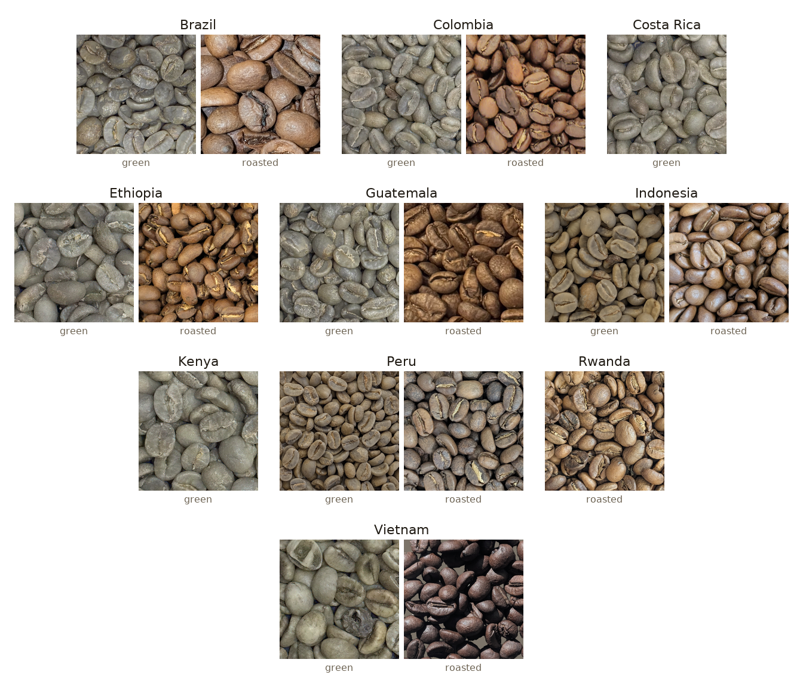

# Coffee Bean CV Classifier

**Try it: [coffee.kasetkin.com](https://coffee.kasetkin.com)**

Take a phone photo of a handful of whole coffee beans and get back the country the coffee was grown in. Our goal is to
recognise **both green (unroasted) and roasted beans** from every country the model knows. We are not there yet: some
countries have photos of both, others of only one (see [What it knows](#what-it-knows)).

What the model sees: one patch per country and roast state, cut from the training photos:

## How it works

1. **Find the beans.** A segmentation model marks the part of the photo covered by beans and ignores the tray, table and
   hands.
2. **Classify.** Patches from that area go through a frozen DINOv3 vision model with a small linear head on top. The
   patch scores are pooled into one score per country.
3. **Refuse when unsure.** If the photo does not look like the training data (no beans, other seeds, ground coffee),
   an out-of-distribution guard declines to answer instead of guessing.

The same code runs from the command line and behind a small public web app: upload a photo, see the bean mask, then
the scores.

## What it knows

- **10 countries:** Brazil, Colombia, Costa Rica, Ethiopia, Guatemala, Indonesia, Kenya, Peru, Rwanda and Vietnam. The
  coffees are listed in [dataset/classes.txt](dataset/classes.txt).
- **Green and roasted, so far:** Brazil, Colombia, Guatemala, Indonesia and Peru have photos of both (Ethiopia and
  Vietnam have one roasted photo each); Kenya and Costa Rica are green only; Rwanda is roasted only. Filling the gaps
  is what the goal above needs. The green Indonesia and Peru photos arrived on 2026-10-21, after the live model was
  trained: it has seen those two countries roasted only.
- **The country is the only label.** The farm region, grade, variety and farm name are recorded for each coffee but
  never predicted.
- **Photos from several phones and cameras** (Pixel, iPhone, OnePlus, Sony), all treated alike.

## How good it is

On held-out photos the live model scores about 0.97 macro-F1. Those photos come from the same bags of beans and the same
cameras as the training photos, so this is **not** an estimate of accuracy on a new phone or a new bag of coffee. That
test does not exist yet. Details and history: [docs/status.md](docs/status.md).

## Where to go next

| If you want to… | Read |
|---|---|
| Set up the dev environment, run the checks, add photos | [docs/development.md](docs/development.md) |
| See the live model, its numbers and how it got there | [docs/status.md](docs/status.md) |
| Run, deploy or roll back the web app | [webapp/README.md](webapp/README.md) |
| Browse experiment records | [experiments/README.md](experiments/README.md), [EXPERIMENTS_LOG.md](EXPERIMENTS_LOG.md) |
| Learn the project's vocabulary | [GLOSSARY.md](GLOSSARY.md) |
| Understand why things are the way they are | [docs/adr/](docs/adr/) |
| Review or write a change | [CODING_STANDARDS.md](CODING_STANDARDS.md) |
